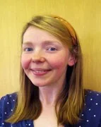

- **Speaker:** [Elizabeth Lewis](https://research.manchester.ac.uk/en/persons/elizabeth-lewis-2/) (University of Manchester)
- **Date and Time:** Tuesday 3 November 2026, 13:15
- **Location:** [6 East 2.1](https://www.bath.ac.uk/timetable/roominfo/6E2-1.htm), University of Bath
- **Series:** [Applied and Interdisciplinary Mathematics Seminar](https://bath-aims.github.io/events/current_seminars.html)

## Abstract

Water management is a substantial practical challenge. Because rain falls everywhere, water can be managed anywhere, and both the complexity of the system and the number of possible interventions are very large. Producing evidenced management plans is therefore difficult, and we rely on models and data to lay out evidence in a structured way, explore options, and support decisions with critical scrutiny. In practice, water is managed at different scales and in separate silos: in England, surface water flooding is the responsibility of local authorities, river flooding of the Environment Agency, water supply of regional water companies, and water quality of several organisations. These elements are, however, parts of one interacting system, and implementation of interventions, and the funding of them, could be considerably more efficient if their benefits were assessed together. Managing water in an integrated way has long been an ambition, but technical and logistical barriers have so far limited progress. There is now both political momentum, through the government's water reform programme, and technological capability for integrating evidence systems. We have been working with the Greater Manchester Integrated Water Management team, who are leading this approach, to design and develop the informatics infrastructure that supports it. This seminar presents that work: mapping the complex system of water processes, establishing a data catalogue, reviewing evidence on which important processes are missing from current modelling frameworks, and designing an integrated modelling system, including where AI can usefully be applied. The breadth of this work provides a basis for discussing where mathematics could improve operational hydrology. Topics will include formulating well-posed questions, scenario testing and optioneering, information theory and its relationship to data availability, model selection and benchmarking, sensitivity analysis, calibration and validation strategies, and the quantification and reduction of uncertainty.

## Research visit

Elizabeth Lewis will also be visiting the Department of Mathematical Sciences on **Wednesday 4 November 2026**, and would be pleased to meet with interested researchers who would like to talk about interesting problems. Please get in touch with the contact below to arrange a meeting.

## Organiser and contact

Phil Trinh (Mathematical Sciences)

Contact: <a href="mailto:hppt20@bath.ac.uk">Phil Trinh</a>
